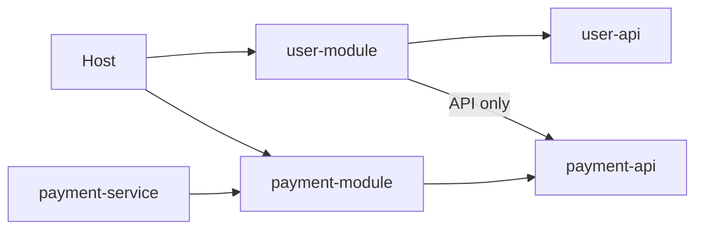
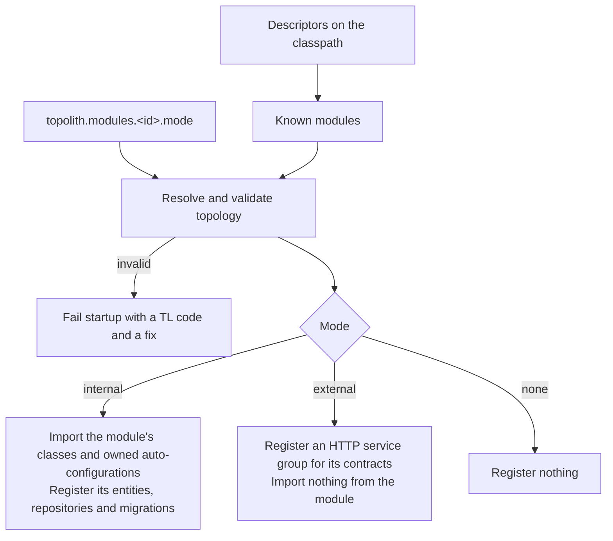
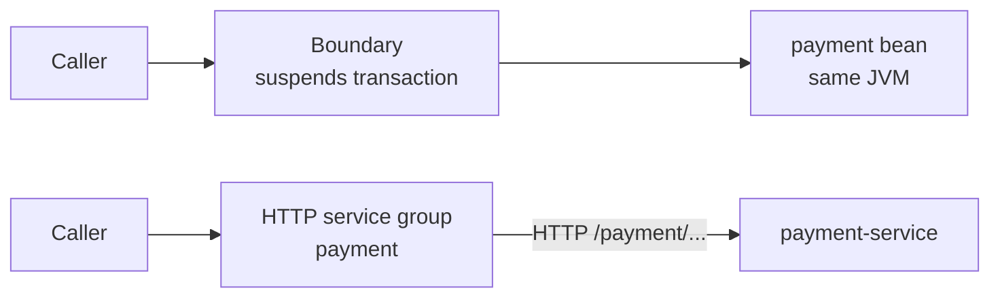
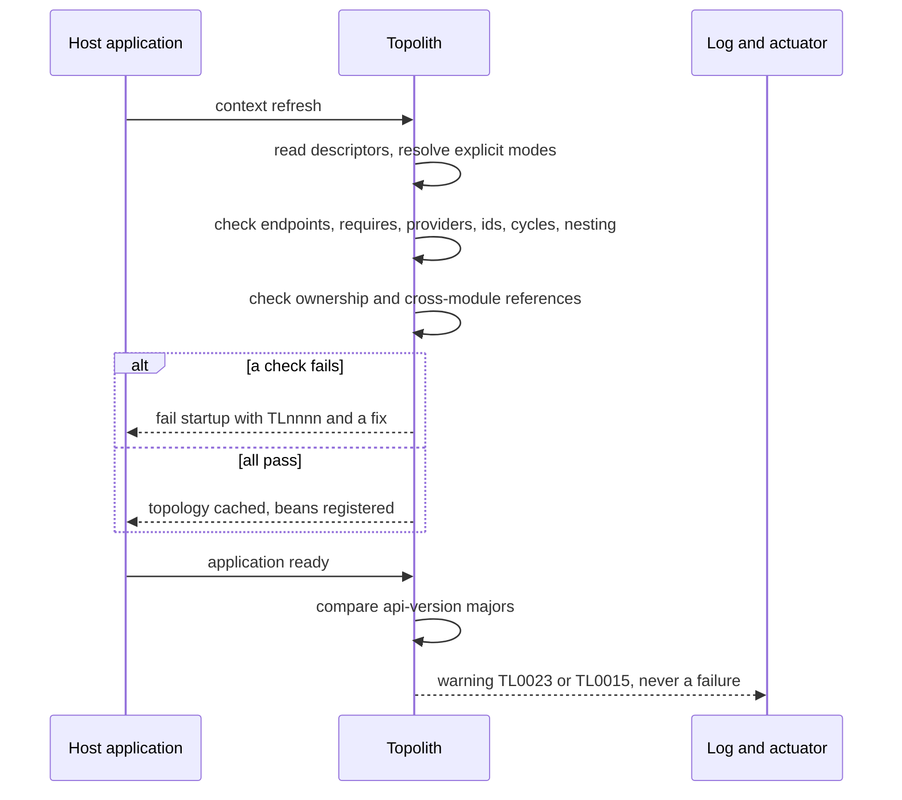

# How it fits together

## Module anatomy

A business module is split into artifacts so that other modules depend only on its contract.

- `<id>-api`: the contract interfaces, value types and exceptions other modules may use, plus the API declaration.
- `<id>-module`: the implementation, with `@TopolithModule` on its root `package-info.java`.
- `<id>-service`: an optional thin Spring Boot application that runs the module alone, so other hosts can reach it as
  `external`.
- **Hosts**: Spring Boot applications that depend on module JARs and choose each module's mode.

The annotation processor writes `META-INF/topolith/modules/<id>.properties` for the implementation and
`META-INF/topolith/apis/<id>.properties` for the API artifact. These generated files are the runtime format that
Topolith reads. The module's root is the package that carries the annotation.

## Activation at startup

The host scans only its own package. Topolith resolves each module's mode from configuration and then registers
only what that mode needs.

Auto-configurations owned by a module that is not `internal` are removed, so a `none` or `external` module leaves no
trace even when its implementation JAR is present.

## Internal and external call path

The caller injects the contract interface and never knows which mode is active.

The top row is `internal`, the bottom row `external`.

An internal call suspends the caller's transaction, the same way a remote call is never part of it. An external call
goes over HTTP under the module's fixed `/<id>` prefix with connect and read timeouts. Declared exceptions come back
as the same type; transport failures become `ModuleUnavailableException`. See [Semantic parity](parity.md).

## Startup validation

The version check at readiness is asynchronous for external modules. It warns and never changes readiness. Every code
is listed on the [diagnostic codes](diagnostics.md) page.
