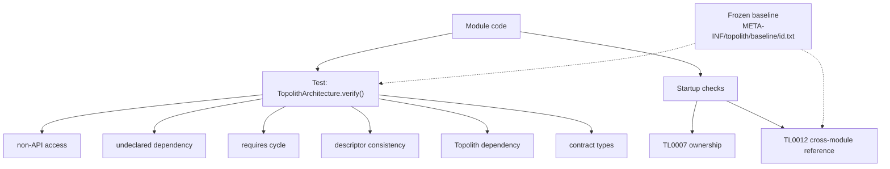

# Boundaries

Topolith checks module boundaries itself at three layers. Spring Modulith is not required.

| Layer | Mechanism | Default |
|---|---|---|
| Build | Other modules depend only on `*-api` artifacts. | Your project layout |
| Test | `TopolithArchitecture.verify()`: ArchUnit rules derived from the descriptors. | Fails |
| Startup | No beans, auto-configurations, entities or repositories of a non-internal module; no internal class referencing another module's non-API class. | Fails |

## The ArchUnit rules

`TopolithArchitecture` (in `topolith-spring-test`) reads module descriptors and checks:

- a module reaches another only through its API packages, and only if the other is in its `requires` or `optional`;
- the descriptors name no duplicate id and no nested module packages;
- `requires` has no cycle (`optional` edges never count);
- module code depends on Topolith only through its annotation and contract packages, so business code cannot branch on
  the topology;
- contract signatures use no `Page`, `Stream`, `InputStream`, entity, Hibernate proxy or persistent collection.

Call `TopolithArchitecture.verify()` from a test in the module. It also fails when it finds no module descriptor.

## The frozen baseline

An adopted legacy repository usually has cross-module references that cannot be fixed on day one. Freeze them and let
only new violations fail:

- `TopolithBaseline.generate` writes `META-INF/topolith/baseline/<id>.txt` from the frozen ArchUnit store. Each line is
  `<referencing class> -> <referenced class>`; blank lines and `#` comments are ignored.
- The startup check reads that packaged file and passes the frozen pairs. A new reference fails with `TL0012` naming
  both classes. A malformed file, or a second copy, fails with `TL0030`.
- The baseline can only shrink: removing a violation shrinks it, and a new violation is never accepted by editing around
  it.

## Startup ownership

Startup fails with `TL0007` when a non-internal module owns a registered bean, auto-configuration, entity or
repository, found through the declaring class or resource and not through the bean type alone. A host scan that
covers an internal module fails with `TL0018`; an internal module bean that makes an auto-configuration back off
fails with `TL0031` (persistence beans fail with `TL0019`).

## Planned

An optional bridge to Spring Modulith's verification and data-ownership checks are on the [roadmap](roadmap.md); they
are not in 0.1.
