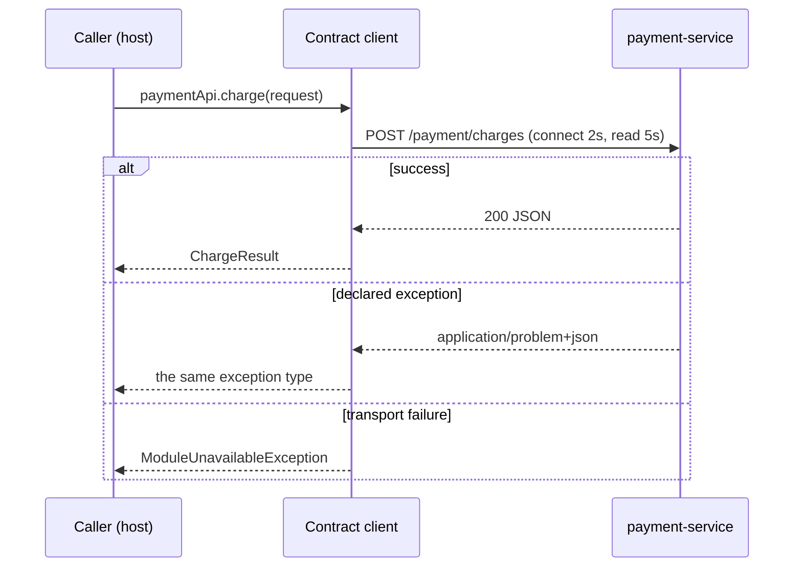

# External mode

In `external` mode a host calls a module through an HTTP client generated from the module's contract, and imports
nothing of its implementation.



## The contract

By default the `*-api` contract interface carries `@HttpExchange`, and the module's `@RestController` implements it
(it may delegate to a service). External mode registers one HTTP service group, named after the module, for its
provided contracts. A host needs `spring-boot-starter-restclient`; without an HTTP client stack, or with a contract
that has no `@HttpExchange`, startup fails with `TL0026`.

If a contract should not depend on `spring-web`, keep a separate HTTP interface that extends it and map it with
`topolith.modules.<id>.remote.http-interface.<contract FQN>`. The keys are case-sensitive class names, so the
property source must preserve case (environment variables do not).

## Choosing the endpoint

Set exactly one of `remote.url` (a fixed endpoint) or `remote.service-id` (discovery), never both:

<!-- snippet: samples/hosts/hybrid/src/main/resources/application.yml#hybrid-modes -->
```yaml
topolith:
  modules:
    user:
      mode: internal
      expose:
        enabled: true
    payment:
      mode: external
      remote:
        # payment-service's port (8081); HybridPaymentTest overrides it with the container's mapped port
        url: http://localhost:8081
        connect-timeout: 2s
        read-timeout: 5s
```

The `connect-timeout` and `read-timeout` values shown are the defaults.

- `remote.url` is combined with the provider's fixed `/<id>` prefix and becomes the group's base URL.
- `remote.service-id` resolves `lb://<service-id>/<id>` through Spring Cloud LoadBalancer and any `DiscoveryClient`.
  It needs `spring-cloud-starter-loadbalancer` (`TL0009` otherwise).

Neither or both, or a value that contradicts an explicit Boot `spring.http.serviceclient.<id>` property, fails with
`TL0003`.

## Timeouts

Every group has timeouts, with defaults of 2 seconds to connect and 5 seconds to read. Override them with
`remote.connect-timeout` and `remote.read-timeout`. Boot's `spring.http.serviceclient.<id>.*` and
`spring.http.clients.*` timeouts also replace the defaults, but setting both a Topolith and a Boot timeout for the same
group to different values fails with `TL0003`. See the [configuration reference](guide/configuration.md).

## Errors

- **Declared exceptions** (unchecked, in the contract's API packages) cross HTTP as `application/problem+json` and are
  rebuilt as the same type on the caller's side. The message is carried; the caller's HTTP exception travels as a
  suppressed exception.
- **Transport failures** (connection refused, timeouts, 502, 503 or 504 without a Topolith problem, no instances from
  the load balancer, an open circuit) raise `ModuleUnavailableException`. Its message names only the module and the
  kind of failure, never a URL or downstream body. After a read timeout the call may have run.
- **Anything else** raises an unchecked exception whose type is unspecified. An undeclared exception's message is not
  sent by Topolith.

A contract method that declares a checked exception fails startup with `TL0027`.

## Exposing a module

A module served by a `*-service`, or by a host that others call, exposes its routes under `/<id>` when
`topolith.modules.<id>.expose.enabled` is `true`. It defaults to `false` everywhere, so a monolith serves nothing by
default. Only an `internal` module in a servlet application can be exposed (`TL0003`, `TL0028`). For security, Topolith
registers no filter chain; it provides the `ExposedEndpoints` and `ExposedRequestMatcher` beans for your own
`SecurityFilterChain`.

## Version readiness

At readiness the host compares the major `api-version` of its `*-api` JAR with the remote provider's, read from
`/<id>/.topolith/api-version`. A mismatch logs `TL0023`; an unreachable or unreadable endpoint logs `TL0015`. Neither
fails startup.

## Refreshing an endpoint

With `topolith-spring-cloud`, changing a URL, a service id (to another service id) or a timeout in the environment
rebuilds that client in place; calls in flight finish on the old client. Invalid settings keep the old client and log
`TL0011`. Switching between URL and service id needs a restart (`TL0010`, reported as `restartPending`).

## Customizing the client

`ModuleClients.configure("payment", customizer)` adjusts a module's client. A customizer cannot replace the base URL,
request factory, interceptors or message converters.

## Observing calls

Each call to a contract of an internal, loopback or external module made from outside that module is one Micrometer
Observation named `topolith.module.call`, recorded on the caller's side and the same in every mode. It needs an
`ObservationRegistry` bean; without one nothing is observed. Its contextual name is
`<module.id> <contract simple name>.<method>`, and its low-cardinality keys are `module.id`, `module.mode`,
`caller.module` (the calling module's id, or `_host` for host code), `contract`, `method` and `exception` (`none`, the
declared exception class's simple name, or `undeclared`). In loopback and external mode Spring's `http.client.requests`
observation is its child, and tracing headers are Micrometer Tracing's.

Turn it off with Micrometer's own means: an `ObservationPredicate`, or
`management.observations.enable.topolith=false`. Topolith has no property of its own. To rename the observation or
change its keys, define one `ModuleCallObservationConvention` bean (two fail startup with `TL0033`) or register a
`GlobalObservationConvention<ModuleCallContext>`; the types are `@Incubating` in
`io.github.rey5137.topolith.spring.boot.observation`.

## Carrying MDC values and the tenant

A loopback or external call can carry the caller's MDC values and tenant to the provider, so the provider logs and
queries as the caller does; an internal call needs nothing, since the provider runs on the caller's thread. List the
MDC keys to send in `topolith.context.mdc-keys` (empty by default, at most 16, each letters, digits, `.`, `_` and `-`
starting with a letter or digit, distinct ignoring case); each key with a value is sent as a `Topolith-Mdc-<key>`
header, UTF-8 and percent-encoded. Nothing else in MDC leaves the process. For the tenant, expose one `TenantContext`
bean (`@Incubating`, in `io.github.rey5137.topolith.spring.boot`) that adapts the holder your application keeps it in,
as the payment service does for the sample's holder:

<!-- snippet: samples/payment/payment-service/src/main/java/io/github/rey5137/topolith/samples/payment/service/SampleTenants.java#sample-tenants -->
```java
/** Adapts the sample's {@link Tenants} holder to the tenant a caller's calls carry (R-EXT-12). */
@Component
class SampleTenants implements TenantContext {
    @Override
    public String current() {
        return Tenants.current();
    }

    /** A real service checks {@code tenant} against {@code principal} here and throws to reject it. */
    @Override
    public Scope open(String tenant, Principal principal) {
        String previous = Tenants.current();
        Tenants.set(tenant);
        return () -> Tenants.set(previous);
    }
}
```

The caller sends `Topolith-Tenant` from `current()`. On the provider, a module's route puts each sent MDC value, removes
every listed key the request does not carry (even one a server filter put), calls `open` with the sent tenant (null
when none was sent) and the request's principal, and restores the previous state when the request completes, normally
or not. Any client that reaches a module's route can send these headers, and a loopback module's routes are on your
server's own port, so `open` is where you decide whether the request's principal may act for the tenant: throw to
reject it, and the route answers 403 without calling the provider.

An MDC value over 1024 characters once encoded is not sent and logs `TL0035` naming the key; a tenant over that limit
fails the call with a `TopolithException` carrying `TL0038`. A header that does not decode, or is over the limit,
answers 400. An invalid key list, or two `TenantContext` beans, fails startup with `TL0034`. Routes outside every module
ignore these headers. Trace and baggage propagation stay Micrometer Tracing's.
