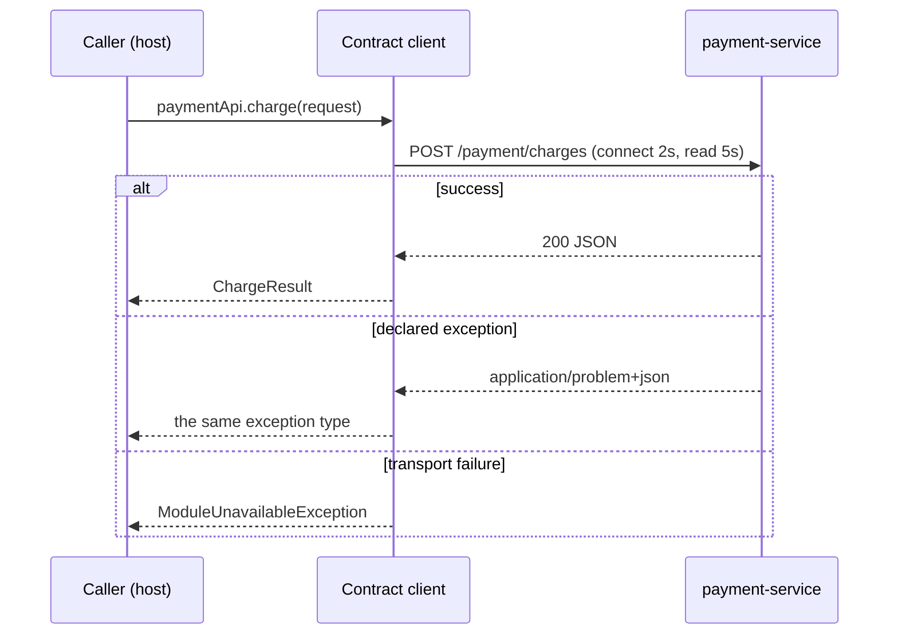

# External mode

In `external` mode a host calls a module through an HTTP client generated from the module's contract, and imports
nothing of its implementation.



## The contract

By default the `*-api` contract interface carries `@HttpExchange`, and the module's `@RestController` implements it
(it may delegate to a service). External mode registers one HTTP service group, named after the module, for its
provided contracts. A host needs `spring-boot-starter-restclient`; without an HTTP client stack, or with a contract
that has no `@HttpExchange`, startup fails with `TL0026`.

If a contract should not depend on `spring-web`, keep a separate HTTP interface that extends it and map it with
`topolith.modules.<id>.remote.http-interface.<contract FQN>`. The keys are case-sensitive class names, so the
property source must preserve case (environment variables do not).

## Choosing the endpoint

Set exactly one of `remote.url` (a fixed endpoint) or `remote.service-id` (discovery), never both:

<!-- snippet: samples/hosts/hybrid/src/main/resources/application.yml#hybrid-modes -->
```yaml
topolith:
  modules:
    user:
      mode: internal
      expose:
        enabled: true
    payment:
      mode: external
      remote:
        # payment-service's port (8081); HybridPaymentTest overrides it with the container's mapped port
        url: http://localhost:8081
        connect-timeout: 2s
        read-timeout: 5s
```

The `connect-timeout` and `read-timeout` values shown are the defaults.

- `remote.url` is combined with the provider's fixed `/<id>` prefix and becomes the group's base URL.
- `remote.service-id` resolves `lb://<service-id>/<id>` through Spring Cloud LoadBalancer and any `DiscoveryClient`.
  It needs `spring-cloud-starter-loadbalancer` (`TL0009` otherwise).

Neither or both, or a value that contradicts an explicit Boot `spring.http.serviceclient.<id>` property, fails with
`TL0003`.

## Timeouts

Every group has timeouts, with defaults of 2 seconds to connect and 5 seconds to read. Override them with
`remote.connect-timeout` and `remote.read-timeout`. Boot's `spring.http.serviceclient.<id>.*` and
`spring.http.clients.*` timeouts also replace the defaults, but setting both a Topolith and a Boot timeout for the same
group to different values fails with `TL0003`. See the [configuration reference](guide/configuration.md).

## Errors

- **Declared exceptions** (unchecked, in the contract's API packages) cross HTTP as `application/problem+json` and are
  rebuilt as the same type on the caller's side. The message is carried; the caller's HTTP exception travels as a
  suppressed exception.
- **Transport failures** (connection refused, timeouts, 502, 503 or 504 without a Topolith problem, no instances from
  the load balancer, an open circuit) raise `ModuleUnavailableException`. Its message names only the module and the
  kind of failure, never a URL or downstream body. After a read timeout the call may have run.
- **Anything else** raises an unchecked exception whose type is unspecified. An undeclared exception's message is not
  sent by Topolith.

A contract method that declares a checked exception fails startup with `TL0027`.

## Exposing a module

A module served by a `*-service`, or by a host that others call, exposes its routes under `/<id>` when
`topolith.modules.<id>.expose.enabled` is `true`. It defaults to `false` everywhere, so a monolith serves nothing by
default. Only an `internal` module in a servlet application can be exposed (`TL0003`, `TL0028`). For security, Topolith
registers no filter chain; it provides the `ExposedEndpoints` and `ExposedRequestMatcher` beans for your own
`SecurityFilterChain`.

## Version readiness

At readiness the host compares the major `api-version` of its `*-api` JAR with the remote provider's, read from
`/<id>/.topolith/api-version`. A mismatch logs `TL0023`; an unreachable or unreadable endpoint logs `TL0015`. Neither
fails startup.

## Retry, circuit breaker and idempotency

Retry and a circuit breaker are per module and off by default. They need `topolith-spring-cloud`; the breaker also
needs exactly one `Resilience4JCircuitBreakerFactory` bean, for example from
`spring-cloud-starter-circuitbreaker-resilience4j`. A missing piece fails startup with `TL0041`. They apply to
`external` and `loopback` modules; a `none` or `internal` module with these keys fails with `TL0003`.

Set them under `topolith.modules.<id>.remote`:

| Key | Default | Meaning |
|---|---|---|
| `retry.max-attempts` | `1` | Attempts per call, from 1 to 10; `1` is off. |
| `retry.initial-backoff` | `100ms` | Wait before the first retry. |
| `retry.multiplier` | `2.0` | Growth of the wait, at least `1.0`. |
| `retry.max-backoff` | the larger of `1s` and `initial-backoff` | Cap on the wait. |
| `retry.safe-methods-idempotent` | `false` | Treat `GET`, `HEAD`, `OPTIONS` and `TRACE` exchanges as idempotent. |
| `circuit-breaker.enabled` | `false` | Turns the breaker on. |
| `circuit-breaker.failure-rate-threshold` | `50` | Percent of failed calls that opens the circuit. |
| `circuit-breaker.sliding-window-size` | `100` | Calls the failure rate is measured over. |
| `circuit-breaker.minimum-number-of-calls` | `10` | Calls needed before the circuit can open. |
| `circuit-breaker.wait-duration-in-open-state` | `60s` | Time before the circuit lets a probe call through. |

- **Idempotency is declared, never guessed.** Put `@Idempotent` on a contract method (or the interface) in the API
  package; the processor writes it into the descriptor and startup checks the two agree (`TL0040`). A method that is not
  declared is never retried, whatever its HTTP method. `retry.safe-methods-idempotent=true` also admits `GET`, `HEAD`,
  `OPTIONS` and `TRACE` exchanges. Removing `@Idempotent` from a method, or narrowing it, is a breaking change of the
  API: bump the API's `api-version` major, because a caller on the older API jar keeps retrying the method.
- **What is retried.** Only a transient provider failure of an idempotent call: a connection failure, a timeout, or a
  502, 503 or 504 without a Topolith problem. A declared exception, a 4xx, a 429 and a 500 are returned at once. A
  retried call is one observation and ends in the same `ModuleUnavailableException` as an unretried one.
- **The breaker counts provider-hop failures only.** A declared exception crosses it as its own type and never opens the
  circuit; an open circuit raises `ModuleUnavailableException` (kind `circuit open`) without calling the provider. The
  retry sits outside the breaker, so each attempt enters it and a retry stops as soon as the circuit opens. Topolith
  alone owns breaker `<id>`: another source configuring it, an `@HttpServiceFallback` for the group, or a Resilience4j
  bulkhead fails startup with `TL0003`. Spring Cloud's global HTTP-service breaker
  would wrap every group on another thread, so Topolith defaults `spring.cloud.circuitbreaker.http-services.enabled`
  to `false` while a module uses either feature. Setting it to `true`, or a Spring Cloud HTTP-service breaker
  configurer bean in the context, together with a module that uses them fails startup with `TL0003`.

The `samples/hosts/monolith` tests show both: `MonolithLoopbackRetryTest` retries the `@Idempotent` `PaymentApi.find`
past a seeded loopback fault while the `charge` mutation makes one attempt, and `MonolithBreakerPaymentTest` and
`MonolithMockBreakerTest` show declared payment exceptions surviving the breaker in loopback and external runs.

## Refreshing an endpoint

With `topolith-spring-cloud`, changing a URL, a service id (to another service id) or a timeout in the environment
rebuilds that client in place; calls in flight finish on the old client. Invalid settings keep the old client and log
`TL0011`. Switching between URL and service id needs a restart (`TL0010`, reported as `restartPending`).

The same event refreshes an `external` module's resilience settings, each group on its own:

- A change under `remote.retry.*` swaps only the retry policy, including turning retry on or off. The running circuit
  breaker and its open or closed state are untouched.
- A change under `remote.circuit-breaker.*` rebuilds only the breaker, closed with an empty window under the new
  thresholds, or removes it when `enabled` becomes `false`. Retry is untouched.
- Changing only the URL, service id or a timeout touches neither.
- A call captures its retry policy and its breaker once, when it starts, and uses them for every attempt: a call in
  flight finishes on the previous policy and breaker and never records into a rebuilt one. Invalid settings, a missing or unsupported
  `CircuitBreakerFactory` or a failed rebuild keep the running policy and breaker, log `TL0011` and show on the
  `topolith` actuator endpoint.

Spring Cloud applies its global breaker only at startup, so turning retry or the breaker on by refresh is restart-only
for a module whose startup left that global breaker applied (every module had them off and the key was not set to
`false`). The refresh is not applied, `TL0010` names the module and key, and `restartPending` stays until both are off
again. Set `spring.cloud.circuitbreaker.http-services.enabled=false` up front to turn them on and off by refresh.

On a `loopback` module, `remote.retry.*` and `remote.circuit-breaker.*` are restart-only like its other client
settings: a change logs `TL0010` and keeps `restartPending` until the keys match their running values again.

## Customizing the client

`ModuleClients.configure("payment", customizer)` adjusts a module's client. A customizer cannot replace the base URL,
request factory, interceptors or message converters.

## Observing calls

Each call to a contract of an internal, loopback or external module made from outside that module is one Micrometer
Observation named `topolith.module.call`, recorded on the caller's side and the same in every mode. It needs an
`ObservationRegistry` bean; without one nothing is observed. Its contextual name is
`<module.id> <contract simple name>.<method>`, and its low-cardinality keys are `module.id`, `module.mode`,
`caller.module` (the calling module's id, or `_host` for host code), `contract`, `method` and `exception` (`none`, the
declared exception class's simple name, or `undeclared`). In loopback and external mode Spring's `http.client.requests`
observation is its child, and tracing headers are Micrometer Tracing's.

Turn it off with Micrometer's own means: an `ObservationPredicate`, or
`management.observations.enable.topolith=false`. Topolith has no property of its own. To rename the observation or
change its keys, define one `ModuleCallObservationConvention` bean (two fail startup with `TL0033`) or register a
`GlobalObservationConvention<ModuleCallContext>`; the types are `@Incubating` in
`io.github.rey5137.topolith.spring.boot.observation`.

## Carrying MDC values and the tenant

A loopback or external call can carry the caller's MDC values and tenant to the provider, so the provider logs and
queries as the caller does; an internal call needs nothing, since the provider runs on the caller's thread. List the
MDC keys to send in `topolith.context.mdc-keys` (empty by default, at most 16, each letters, digits, `.`, `_` and `-`
starting with a letter or digit, distinct ignoring case); each key with a value is sent as a `Topolith-Mdc-<key>`
header, UTF-8 and percent-encoded. Nothing else in MDC leaves the process. For the tenant, expose one `TenantContext`
bean (`@Incubating`, in `io.github.rey5137.topolith.spring.boot`) that adapts the holder your application keeps it in,
as the payment service does for the sample's holder:

<!-- snippet: samples/payment/payment-service/src/main/java/io/github/rey5137/topolith/samples/payment/service/SampleTenants.java#sample-tenants -->
```java
/** Adapts the sample's {@link Tenants} holder to the tenant a caller's calls carry (R-EXT-12). */
@Component
class SampleTenants implements TenantContext {
    @Override
    public String current() {
        return Tenants.current();
    }

    /** A real service checks the request's tenant against its principal here and throws to reject it. */
    @Override
    public Scope open(Request request) {
        String previous = Tenants.current();
        Tenants.set(request.tenant());
        return () -> Tenants.set(previous);
    }
}
```

The caller sends `Topolith-Tenant` from `current()`. On the provider, a module's route puts each sent MDC value, removes
every listed key the request does not carry (even one a server filter put), calls `open` with a
`TenantContext.Request` (the sent tenant, null when none was sent, the request's principal and the id of the module
called), and restores the previous state when the request completes, normally or not. Any client that reaches a module's route can send these headers, and a loopback module's routes are on your
server's own port, so `open` is where you decide whether the request's principal may act for the tenant: throw to
reject it, and the route answers 403 without calling the provider.

An MDC value over 1024 characters once encoded, or with a control character, is not sent and logs `TL0035` naming the
key; a tenant over that limit or with a control character fails the call with a `TopolithException` carrying `TL0038`.
A header that does not decode, is over the limit, or decodes to a value with a control character answers 400, which
keeps a client from forging log lines. A request carrying `Topolith-Tenant` to a host with no `TenantContext` bean
answers 500 with `TL0039` logged, so a provider never runs with a tenant it cannot honour; the caller gets the
unspecified exception. The values are current on the request's dispatch threads only, and your own interceptors registered through `WebMvcConfigurer` see
them too (a `MappedInterceptor` bean runs before them). A host that exposes no module checks nothing. An invalid key list, or two `TenantContext` beans, fails startup with `TL0034`. Routes outside every module
ignore these headers. Trace and baggage propagation stay Micrometer Tracing's.

## Authenticating calls

Each loopback or external module's client authenticates its calls through one outgoing-auth hook, chosen by
`topolith.modules.<id>.auth.type`:

| `auth.type` | What a call sends |
|---|---|
| `relay` (default) | `Authorization: Bearer <token>` when the calling thread's `Authentication` is a bearer token (a `JwtAuthenticationToken` or `BearerTokenAuthentication`); nothing otherwise |
| `client-credentials` | The access token Spring Security's OAuth2 client obtains for the registration `auth.registration-id` |
| `none` | Nothing |

With `relay`, give the provider a resource-server configuration and it sees the caller's name and authorities, as an
internal provider sees the caller's own `SecurityContext`. A caller logged in without a bearer token (a session login,
anonymous) relays nothing, so a loopback or external provider sees what its security chain makes of a request without
credentials. Without Spring Security's resource-server classes there is nothing to relay and no hook is installed.

With `client-credentials`, Topolith builds its own `AuthorizedClientServiceOAuth2AuthorizedClientManager` from your one
`ClientRegistrationRepository` and one `OAuth2AuthorizedClientService` bean (Boot's OAuth2 client starter declares
both) and authorizes the registration for a fixed principal named `topolith:<registration id>`: one token is obtained
and cached whoever calls, and calls outside a servlet request (a scheduled job, an async thread) work. The provider sees
the client's principal, not the caller's. The token request uses your one client-credentials
`OAuth2AccessTokenResponseClient` bean if you declare one; otherwise it has the module's connect and read timeouts
(refreshed with them), and never the module's SSL bundle, since the token endpoint is another server. A token request
that fails on I/O fails the call with `ModuleUnavailableException`. When the provider rejects the token as
`invalid_token` (a plain 401 counts), the call fails, is not retried, and the next call obtains a new token. Missing
OAuth2 client classes, a missing or unknown registration, not exactly one repository and one service, or two token
client beans fail startup with `TL0037`.

To authenticate another way, declare `ModuleClients.authenticate("payment", interceptor)` as a bean: the interceptor
becomes the module's hook, after every interceptor a `ModuleClients.configure` customizer adds. Two hooks for a module,
or one together with an explicit `auth.type`, fail startup with `TL0036`, and so does, on the call, a hook that changes
an `Authorization` header a customizer already set: the call fails with a `TopolithException` and is not sent. An
`auth.*` key on an internal or `none` module, an unknown key or value, or `auth.registration-id` without
`client-credentials` fails startup with `TL0003`. The keys take effect at startup only: a refresh changing one logs
`TL0010` and marks a restart pending.
