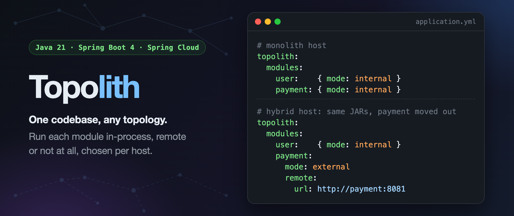

# Topolith



Topolith lets a Spring Boot business module run **in-process**, **remote** or **not at all**, chosen per host in
configuration, without changing the module's code. The same `user` and `payment` modules can ship as one modular
monolith, as separate services, or anything in between, and move between those shapes over time.

```text
topolith:
  modules:
    user:
      mode: internal
    payment:
      mode: external
      remote:
        url: http://payment-service:8081
```

## What you get

- **A module is metadata.** One optional annotation, `@TopolithModule`, on a `package-info.java`. Business code has no
  base class and no framework type.
- **Modes in configuration.** Each host states every module's mode: `internal`, `external` or `none`.
- **Inclusion-based activation.** A module that is not `internal` contributes no beans, routes, entities, tables or
  auto-configurations, even when its JAR is on the classpath.
- **External calls with mandatory timeouts.** A fixed URL or service discovery, ProblemDetail errors that rebuild the
  declared exception on the caller's side, and `ModuleUnavailableException` for transport failures.
- **Fail fast.** An unsatisfiable topology stops startup with a `TLnnnn` code and a fix-it message. Nothing falls back
  silently.
- **Boundary checks.** Descriptor-driven ArchUnit rules with a frozen baseline for legacy code, plus a startup check.
- **Test support.** Per-test module modes and a mock server for external modules.

## Modules

| Artifact | What it is |
|---|---|
| `topolith-bom` | The platform BOM: imports Spring Boot, Spring Cloud and Topolith versions in one place. |
| `topolith-core` | Descriptor model, module graph and validation. `@TopolithModule` and `ModuleUnavailableException` live here. Depends on the JDK only. |
| `topolith-spring-boot` | Activation, modes, HTTP service groups, startup validation and the `topolith` actuator endpoint. |
| `topolith-spring-cloud` | Optional. Service-id discovery with Spring Cloud LoadBalancer and live refresh of external endpoints. |
| `topolith-processor` | The annotation processor that generates module descriptors from `@TopolithModule`. |
| `topolith-spring-test` | `@TopolithModuleMode`, `@TopolithMock`, the mock server, `TopolithArchitecture` and `TopolithBaseline`. |

## Where next

- New here? Read [Why Topolith](why.md), then [Getting started](guide/getting-started.md).
- To see how the parts connect, read [How it fits together](architecture.md).
- Adopting an existing service? Follow the [legacy adoption checklist](guide/legacy-adoption.md).
- Looking up a property or an error code? See the [configuration reference](guide/configuration.md) and the
  [diagnostic codes](diagnostics.md).
- Topolith is pre-1.0: read [API stability](stability.md).
