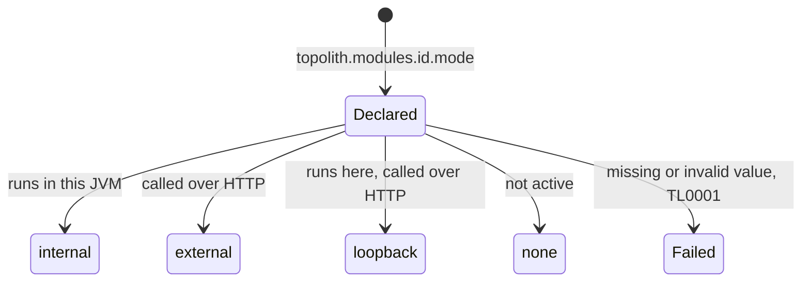

# Modes

Every host declares a mode for every module it knows, in `topolith.modules.<id>.mode`. A module is known when a module
descriptor or an API descriptor on the classpath carries its id. Values are trimmed and case-insensitive.



| Mode | What it contributes | What it leaves out |
|---|---|---|
| `internal` | The module's configuration and packages, its owned auto-configurations, its entities and repositories, and its migrations. | Nothing. It needs the implementation JAR (`TL0002` otherwise). |
| `loopback` | The implementation and an HTTP client calling it on the host server. | Nothing. It needs the implementation JAR (`TL0002`) and a listening servlet server (`TL0026`). |
| `external` | One HTTP service group for the module's provided contracts. | The implementation: no beans, routes, entities, tables or auto-configurations. |
| `none` | Nothing. | Everything, including the client. An `internal` module that `requires` it fails startup (`TL0004`). |

A `none` or `external` module leaves no trace even when its JAR is on the classpath: no component, owned
auto-configuration, entity, repository, migration, route, listener or scheduled task.

## Loopback faults

For a loopback module, `topolith.modules.<id>.loopback.latency` delays responses (default `0`).
`topolith.modules.<id>.loopback.fault.rate` selects the share of failed calls from `0` to `1` (default `0`);
`topolith.modules.<id>.loopback.fault.kind` selects `connection-failure` (default), `unavailable` or `timeout`.
`topolith.modules.<id>.loopback.fault.seed` sets the sequence seed (default `0`).

## No implicit defaults

A missing or invalid mode fails startup with `TL0001`. The only default is for a standalone `*-service`:

<!-- snippet: samples/payment/payment-service/src/main/resources/config/payment-service/application.yml#payment-service-modes -->
```yaml
topolith:
  standalone: payment
  modules:
    payment:
      expose:
        enabled: true
```

`topolith.standalone=<id>` makes that one module default to `internal`. Setting it while another module with a
descriptor is `internal` fails with `TL0025`; with the others `external` or `none` it starts.

## Dependencies between modules

Only `internal` modules are checked for `requires`. A required module counts as available when it is `internal` or
`external`; `none` and unknown modules are not available. The dependencies of an `external` module are met by the
remote service and are not checked locally. `optional` dependencies never fail the graph when absent.

## Persistence and migrations

Internal modules use the host's JPA and Spring Data JDBC by default. Each internal module registers only its own
entities and repositories, and migrates its own scripts under `classpath:db/modules/<id>` with Flyway or Liquibase,
with its own tracking tables, after the host's migrations. A module that brings its own `DataSource` or
entity-manager factory owns the matching entities and repositories; those beans must not be default candidates, or
startup fails with `TL0019`.

## Changing a mode

The running topology never changes without a restart. With `topolith-spring-cloud`, a refreshed mode logs `TL0010`
and the actuator reports `restartPending`. See [External mode](external-mode.md) for endpoint refresh.

## Local overrides in tests

`@TopolithModuleMode` selects a mode per test class. See [Testing](testing.md).
