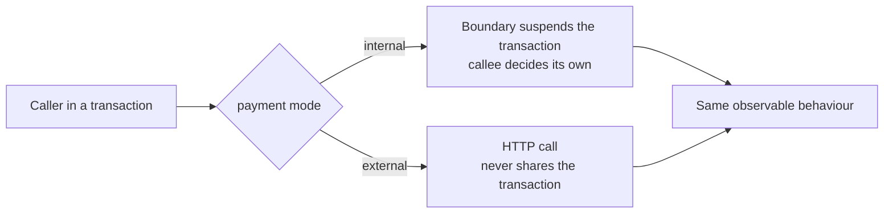

# Semantic parity

Internal and external calls must behave the same way, or changing a mode becomes a trap. Code that only works
in-process is a bug even when every internal-mode test passes.

## What holds in 0.1

| Concern | Rule | How it is enforced |
|---|---|---|
| Transactions | A contract call is never part of the caller's transaction. An internal call suspends the caller's transaction (`NOT_SUPPORTED`); the callee's own `@Transactional` decides whether to start one. | A boundary proxy. The counter `topolith.contract.calls.in.transaction` (tags `module`, `contract`) counts calls made inside an active transaction. |
| Contract types | No `Page`, `Stream`, entities, `InputStream` or lazy proxies in a contract signature. | ArchUnit rule from the module's API packages (see [Boundaries](boundaries.md)). |
| Errors | Declared exceptions keep their type across HTTP; transport failures become `ModuleUnavailableException`. | The provider's problem resolver and the caller's client advice (see [External mode](external-mode.md)). |
| Timeouts | Every external client has connect and read timeouts. | Defaults of 2s and 5s. |

A `final` handler class (`@Controller`, `@RestController` or `@RequestMapping`) that implements a contract of an
internal module cannot be proxied by class, so startup fails with `TL0029`, whether or not the host has a transaction
manager or an `ObservationRegistry` bean. Make the class non-final.

## In-process-only traps

Avoid anything that works only when caller and callee share a JVM:

- a shared transaction across a contract call;
- a mutable argument or result the callee changes for the caller to see;
- `Page`, `Stream`, an entity or a lazy proxy in a contract;
- a `ThreadLocal` context that the callee reads.

Arguments and results must be values.

## Parity tools

[Loopback mode](modes.md) calls an in-process module over HTTP. [Testing](testing.md) covers the by-value proxy and mode matrix; [Modes](modes.md) describes fault injection. [External mode](external-mode.md) explains outgoing authentication, context
propagation and call observations across modes.
