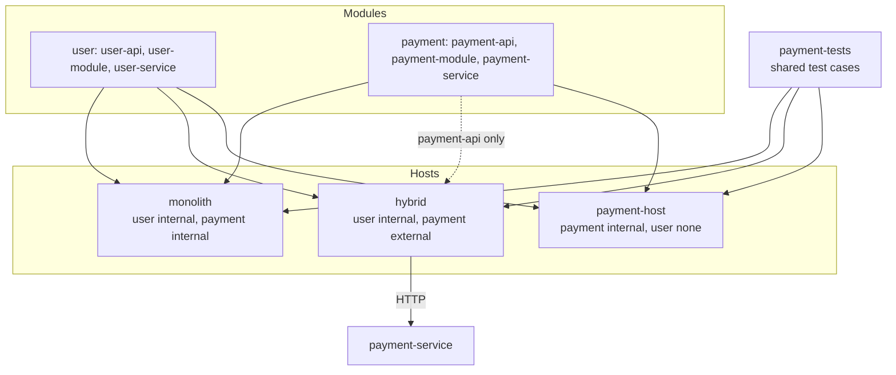

# Samples

The `samples/` directory is a reference adopter. It builds like an outside project would, and the code shown in the
guides is taken from it and checked against it by the build.



## Modules

- `samples/user`: `user-api`, `user-module` and `user-service`. The module places orders and calls payment through
  the payment contract.
- `samples/payment`: `payment-api` (the `PaymentApi` contract, its values and its declared exceptions),
  `payment-module` and `payment-service`, which runs the module alone with `topolith.standalone=payment`.

## Hosts

| Host | Modes | Purpose |
|---|---|---|
| `samples/hosts/monolith` | `user` internal, `payment` internal | One process with both modules. |
| `samples/hosts/hybrid` | `user` internal, `payment` external | `user` calls a separate `payment-service` over HTTP, by fixed URL or Consul. |
| `samples/hosts/payment-host` | `payment` internal, `user` none | A deployable payment host; `user` leaves no beans, routes, tables or auto-configurations. |

The hosts do not inherit Topolith's parent POM. They import only the platform BOM and enforce
`dependencyConvergence` and `requireUpperBoundDeps`, as an outside adopter would.

## Shared tests

`samples/payment-tests` holds the payment test cases that run unchanged against the monolith, hybrid and `none` hosts.
The hybrid end-to-end tests start `payment-service` in a Testcontainers container and reach it by fixed URL and through
Consul discovery. They need Docker and the packaged `payment-service` JAR.

## Running

Install the reactor once, then run a host:

```bash
./mvnw -q install -DskipTests
./mvnw -pl samples/hosts/monolith spring-boot:run
```

For the hybrid topology, start `payment-service` first (port 8081), then the hybrid host (port 8080):

```bash
./mvnw -pl samples/payment/payment-service spring-boot:run
./mvnw -pl samples/hosts/hybrid spring-boot:run
```

See [Getting started](guide/getting-started.md) for the short tour, and the [Worked example](guide/worked-example.md)
for every piece of the samples explained step by step, with recorded requests and responses.
