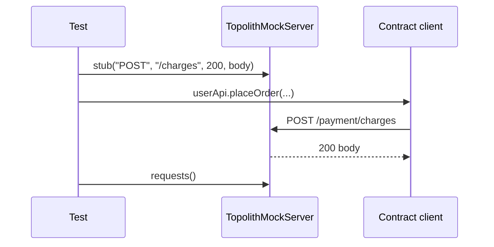

# Testing

`topolith-spring-test` (test scope) supplies helpers for choosing modes per test and for stubbing external modules.

## Choosing a mode per test

`@TopolithModuleMode` selects `INTERNAL`, `EXTERNAL` or `NONE` for one module in a test class. It is repeatable.

<!-- snippet: samples/hosts/monolith/src/test/java/io/github/rey5137/topolith/samples/hosts/monolith/MonolithMockPaymentTest.java#test-helpers-mock -->
```java
@SpringBootTest(classes = MonolithApplication.class,
        properties = "spring.datasource.url=jdbc:h2:mem:monolith-mock;DB_CLOSE_DELAY=-1")
@TopolithModuleMode(id = "user", mode = Mode.INTERNAL)
@TopolithModuleMode(id = "payment", mode = Mode.EXTERNAL)
class MonolithMockPaymentTest {
    @TopolithMock(id = "payment")
    TopolithMockServer paymentMock;

    @Autowired
    UserApi userApi;

    @Test
    void user_places_order_against_mocked_external_payment() {
        paymentMock.stub("POST", "/charges", 200,
                "{\"id\":\"chg-1\",\"reference\":\"ord-1\",\"amount\":10.00,\"status\":\"CHARGED\",\"tags\":[]}");

        OrderView order = userApi.placeOrder(new PlaceOrderRequest("ord-1", new BigDecimal("10.00")));

        assertEquals("chg-1", order.paymentId());
        assertEquals(1, paymentMock.requests().size());
        TopolithMockServer.Request recorded = paymentMock.requests().get(0);
        assertEquals("POST", recorded.method());
        assertEquals("/payment/charges", recorded.path());
        assertEquals("{\"reference\":\"ord-1\",\"amount\":10.00,\"tags\":[]}", recorded.body());
    }
}
```

- The annotation overrides application configuration. If inlined properties, dynamic properties or a
  `@TestPropertySource` set the same `mode`, `remote.url` or `remote.service-id` to a different value, the context
  fails to load with an `IllegalStateException` naming the module, the key and both values.
- Selecting `external` clears `remote.service-id`, so a host that configures a service id still starts and the mock
  URL wins.
- Selecting `none` leaves no contributions of the module in the context.
- The `TopolithTestModes` builder offers the same selection in code.

## By-value parity

Spring TestContext tests check internal module contracts by value by default. Arguments and results cross the same
JSON conversion boundary as remote calls, and mutations or values that cannot round-trip fail the test. Use
`@TopolithByValue({"payment"})` to check only selected module IDs. `ApplicationContextRunner` does not install the
check unless the `TopolithTestModes` builder calls `byValue()`.

Set `topolith.test.parity=warn` to log violations as TL0045 warnings instead of failing the test; the default is `fail`.
The warnings name the module, method and JSON path without logging values. An internal contract provider needs a JSON
HTTP message converter such as Jackson.

A declared exception the provider throws reaches the caller as it would over HTTP: a checked exception named in the
contract method's `throws` clause, a subclass outside the module's API packages as its API-package ancestor, and
`IllegalArgumentException`, `IllegalStateException` or `UnsupportedOperationException` (or a subclass of one) as that
JDK class with its message only. A bean that implements a contract its module lists in `provides` is checked even when
its class lies outside the module's package, such as a factory result.

`TopolithTestSupport.awaitVersionChecks(context, duration)` waits for version checks and their logs to finish and
returns whether they completed within the timeout.

## Stubbing an external module

`@TopolithMock(id = "payment")` injects a `TopolithMockServer` and points the module's client at it.



- `stub(method, path, status, body)` registers a response; `requests()` returns the recorded calls.
- Stubs and recorded requests are cleared before and after each test method; `@BeforeEach` stubs survive, `@BeforeAll`
  stubs do not.
- `problem(method, path, type, message)` writes the same problem response a provider would write for a declared
  exception, so you can test the caller's exception mapping. `unavailable(method, path, downstreamModuleId)` writes the
  provider's 503. Pass the declared contract exception type.
- The mock serves, but does not record, the readiness version check.

## Boundary tests

Add `TopolithArchitecture.verify()` to a test in each module. See [Boundaries](boundaries.md).

## The same tests across topologies

The samples run the same payment test cases against the monolith, hybrid and `none` hosts. See [Samples](samples.md).

## Mode matrix

Run the same contract tests with the provider in `internal`, `loopback` and `external` modes using separate host
configurations. The internal run uses the by-value proxy; loopback crosses HTTP on the host's own server, and external
calls a separate provider. The sample payment tests show the three runs; there is no built-in matrix runner.
